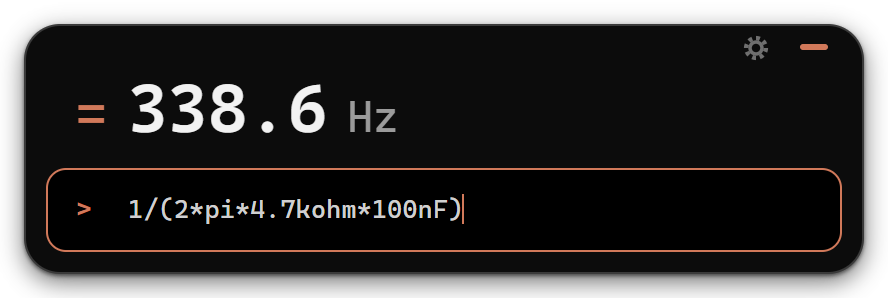
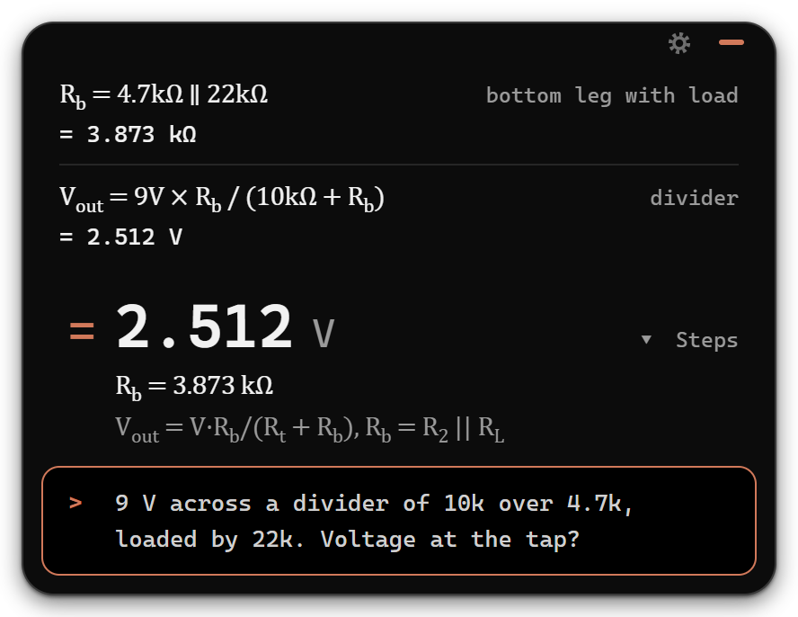
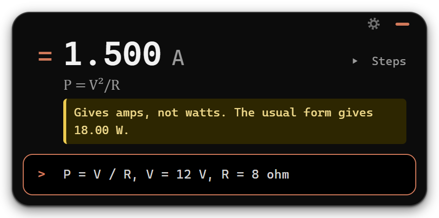

# Slipstick

A small engineering calculator for Windows that stays on top of your other
windows. It answers arithmetic, units and conversions as you type, and can
hand harder problems to Claude if you want it to: typed in words, or pasted
as pictures (a formula, a datasheet row, a small schematic), up to four at
a time.



**[Download the latest installer](https://github.com/pawedfox/slipstick/releases/latest)**
for Windows 11. It is not signed yet, so read [Install](#install) for what
Windows will say when you run it.

Unofficial project. Not affiliated with or endorsed by Anthropic.

Status: version 0.18.0. It is one person's tool, in daily use by its
author; expect rough edges. See
[What is not done](#what-is-not-done).

## What it does

Press **Ctrl+Alt+C** anywhere. A small bar appears at the bottom-right of
the screen with the cursor in it. Type, read the answer, carry on working;
the answer stays visible. **Esc** hides it.

### Plain math, as you type

No account and no network. The answer changes with every key.

| You type | It shows |
|---|---|
| `2.2mA * 4.7kohm` | 10.34 V |
| `1/(2*pi*4.7kohm*100nF)` | 338.6 Hz |
| `10k \|\| 22k \|\| 47k` | 5.998 k |
| `9V * 4.7k / (10k + 4.7k)` | 2.878 V |
| `4k7 + 330` | 5.030 k |
| `6 bar * pi * (25mm)^2` | 1.178 kN |
| `10 Nm * 1500 rpm` | 1.571 kW |
| `10 Nm * 1500 rpm to hp` | 2.106 hp |
| `1500 rpm to Hz` | 25.00 Hz |
| `3.5 bar to psi` | 50.76 psi |
| `12 L/min to gpm` | 3.170 gal/min |
| `100 C to F` | 212.0 °F |
| `25 C + 2 W * 50 C/W` | 125.0 °C |
| `(150 C - 25 C) / 62 C/W` | 2.016 W |
| `250mW in dBm` | 23.98 dBm |
| `10 dBm + 3 dB` | 13.00 dBm |
| `2V / 1V to dB` | 6.021 dB |
| `10kohm + 1/(j*2*pi*1kHz*100nF)` | 10.13 kΩ ∠ −9.043° |
| `230 V @ 0° - 230 V @ 120°` | 398.4 V ∠ −30.00° |
| `VGS = -0.3V * (1 - sqrt(0.1mA / 0.2mA))` | −87.87 mV |
| `re = 25mV / Ic, Ic = 2mA` | 12.50 Ω |
| `F = m * a, m = 5 kg, a = 9.81 m/s^2` | 49.05 N |
| `E = 0.5 * C * V^2, C = 100uF, V = 12V` | 7.200 mJ |
| `12V = I * 8ohm` | 1.500 A |
| `fc = 1/(2*pi*R*C), fc = 10 Hz, R = 1Mohm` | 15.92 nF |
| `Vth = Vcc * R2 / (R1 + R2), Vth = 1.623V, Vcc = 9V, R1 = 100kohm` | 22.00 kΩ |
| `k_B * 300 K / q_e` | 25.85 mV |
| `eps_0 * 1 cm^2 / 1 mm` | 885.4 fF |
| `h_P * c_0 / 650 nm to eV` | 1.907 eV |
| `1 mol * R_gas * 273.15 K / 1 atm` | 22.41 L |
| `(5 V - 2 V) / 20 mA to E24` | 150 Ω |
| `3.3 V +/- 5%` | 3.300 V, with 3.135 V to 3.465 V beneath |
| `0xFF + 1` | 256, with 0x100 and 0b1 0000 0000 beneath |

It understands:

- **Prefixes** (`4.7k`, `100n`, `2.2u`, `1M`, `1meg`) and component notation
  (`4k7`, `2n2`, `4R7`). `m` is milli and `M` is mega.
- **Units, with the dimensions checked.** Electrical (V, A, Ω, F, H, S, W,
  Hz, J, Wh), magnetic (Wb, tesla), time, length, mass, force, pressure
  (Pa, bar, psi, atm), torque (N·m, lb·ft), power (W, hp), angle and
  rotation (deg, rad, rpm), volume and flow (L, gal, L/min, gpm, cfm),
  speed, electronvolts (eV, meV, keV, MeV, GeV) and moles. Volts times
  amps comes out in watts; volts plus amps is refused.
- **Constants,** typed with their subscript, with or without the
  underscore:

  | Typed | Constant | Value |
  |---|---|---|
  | `k_B` or `kB` | Boltzmann's constant | 1.380649e-23 J/K |
  | `q_e` or `qe` | charge on an electron | 1.602176634e-19 C |
  | `c_0` or `c0` | speed of light | 299 792 458 m/s |
  | `g_0` or `g0` | standard gravity | 9.80665 m/s² |
  | `eps_0`, `eps0` or `ε0` | permittivity of free space | 8.8541878188e-12 F/m |
  | `mu_0`, `mu0` or `μ0` | permeability of free space | 1.25663706127e-6 H/m |
  | `h_P` or `hP` | Planck's constant | 6.62607015e-34 J·s |
  | `N_A` or `NA` | Avogadro's number | 6.02214076e23 /mol |
  | `R_gas` or `Rgas` | molar gas constant | 8.314462618 J/(mol·K) |

  An answer lists the constants it used on a line beneath it
  (`g0 = 9.807 m/s²`), so you see the value that went in. Type one alone
  to see it. A single letter is never a constant: `g` is the gram, `k` is
  kilo, and `c` and `q` are yours to name. Write `2 * c0`, not `2 c0`.
- **Standard values, tolerances, hexadecimal and binary.** Each goes at
  the end of what you type and puts a line beneath the answer:

  | You type | It shows | Beneath |
  |---|---|---|
  | `4.4kohm to E12` | 4.7 kΩ | +6.8 %, and the other side: 3.9 kΩ, −11.4 % |
  | `1/(2*pi*10 kHz*10 kohm) to E12` | 1.5 nF | −5.8 %, and the other side: 1.8 nF, +13.1 % |
  | `10kohm +/- 5%` | 10.00 kΩ | 9.500 kΩ to 10.50 kΩ |
  | `3.3 V +/- 100 mV` | 3.300 V | 3.200 V to 3.400 V |
  | `0b1010` | 10 | 0xA and 0b1010 |
  | `255 to hex` | 0xFF | 255 and 0b1111 1111 |
  | `255 to bin` | 0b1111 1111 | 255 and 0xFF |

  - `to E6`, `E12`, `E24`, `E48`, `E96` or `E192` gives the nearest
    standard value of that series, for a resistor, a capacitor or anything
    else. Beneath is how far off it is, and the standard value on the
    other side, so you can take the next one up or down. A value exactly
    midway between two is refused, and Enter names them both.
  - `+/-` (or `±`) and a percentage or an amount gives the range. It comes
    last and is a tolerance on everything before it. It does not work out
    the range of an answer from several values that each have a tolerance.
  - `0x` and `0b` start a number in hexadecimal or binary. A whole answer
    to input that used one is shown in full, with the other bases beneath;
    `to hex` and `to bin` put that base on the big line. Whole numbers
    from 0 to 2^53 only. `2x3` is still two times three: only a nought,
    an `x` and a digit at the start of a number is hexadecimal.
- **Conversions** with `to` (or `in`): `25 mm to in`. Between rpm and Hz
  one revolution is one cycle, so `50 Hz to rpm` is 3000 rpm. The two are
  never mixed in a sum.
- **Hertz only where it is hertz.** `1/(2*pi*R*C)` is a frequency and is
  shown in Hz. `1/(R*C)` is 2π times that, in radians a second, so it is
  shown as `s⁻¹` and not passed off as a cutoff frequency.
- **Temperatures.** A temperature can have a rise added or taken away, so
  junction and heatsink sums work. One temperature less another is a
  difference, shown as `Δ°C` so it is not read as a temperature. Adding
  two temperatures, or doubling one, is refused. Fahrenheit is `°F` or
  `degF` in a sum, because `F` is the farad.
- **Decibels.** Levels in dBm, dBW, dBV and dBu, both ways, and a level
  with gains added or taken away. A ratio becomes decibels when both sides
  have units, so it is known whether it is power or voltage; a bare
  `47 in dB` is left to Claude.
- `||` for parallel, `x` or `×` for multiply, `²` and `³`, `√`, `π`, `%`,
  and the usual functions (`sqrt ln log exp sin cos tan asin acos atan abs`).
- **Complex numbers.** `j` is the imaginary unit, before or after a number:
  `3 + j4`, `j*2*pi*1kHz*100mH`. A magnitude and angle is typed with `∠`
  or `@`: `230 V @ 120°`. The answer shows the magnitude and angle, with
  the real and imaginary parts on a line beneath; `abs`, `arg`, `re`,
  `im` and `conj` take one apart.
- **A name in front**, as you would write it on paper: `VGS = …`.
- **A formula with its values after it**, separated by commas:
  `gain = Rd * gm, Rd = 10kohm, gm = 2.1mS`. A value may use other
  values, in any order. A name may be a unit's letter, as formulas are
  written: alone it is your value, and straight after a number it is the
  unit, so `V = 12V` means what it says. Give every value its unit
  (`10kohm`, not `10k`), and write `2*V`, not `2V`. The formula is worked
  out exactly as you typed it, right or wrong.
- **Solving for the value you left out.** Give every value but one and it
  finds that one: `V = I * R, V = 12V, I = 1.5A` is 8.000 Ω. It works on
  equations that cannot be rearranged, too. Where two values fit that
  differ only in sign, it shows the positive one with the other beneath;
  where two different values fit, it shows neither and, on Enter, names
  both. A value it shows always fits the equation, but it searches for
  answers and can miss one, so "no value was found" does not mean there
  is none. `x` is the times sign, so call the value something else.
- **Values you keep.** Press **Enter** on an answer with a name in front
  and it is kept under that name until you quit Slipstick. Later inputs
  can use the name:

  | You type | It shows |
  |---|---|
  | `R1 = 10kohm`, then Enter | 10.00 kΩ, and "R1 is kept until Slipstick is quit." |
  | `R2 = 22kohm`, then Enter | 22.00 kΩ, kept likewise |
  | `Vcc = 9V`, then Enter | 9.000 V, kept likewise |
  | `Vcc * R2 / (R1 + R2)` | 6.188 V |
  | `R1 \|\| R2` | 6.875 kΩ |
  | `12V = I * R1` | 1.200 mA |

  An answer that used kept values lists them on a line beneath it
  (`Vcc = 9.000 V, R2 = 22.00 kΩ, R1 = 10.00 kΩ`), so a value kept some
  time ago is never used unseen. A name holds the number it had when you
  kept it: keep `R2 = R1 * 2`, then change R1, and R2 stays as it was. A
  name cannot be a unit (`V`, `C`, `m`), because `V * 2` already means two
  volts; use `V1` or `Vin`. Straight after a number a word is still a unit
  or a prefix, so with `k` kept, `2k` is two thousand and twice k is
  `2 * k`. Kept values are held in memory only.

- **Steps, with no AI.** An answer worked out from named values has a
  **Steps** control: a formula with its values after it, anything that
  uses kept values or constants, and a solved equation. It shows each
  value as it was read, then the formula with the values put in:

  | For `Vout = Vin * R2 / (R1 + R2), Vin = 5 V, R1 = 4.7kohm, R2 = 10kohm` | | |
  |---|---|---|
  | `Vin = 5 V` | given | 5.000 V |
  | `R1 = 4.7kohm` | given | 4.700 kΩ |
  | `R2 = 10kohm` | given | 10.00 kΩ |
  | `Vout = 5.000 V × 10.00 kΩ / (4.700 kΩ + 10.00 kΩ)` | values put in | 3.401 V |

  So you can see how every unit and prefix was read. An equation is
  solved by trial, not by rearranging, so its steps show the value found
  and then the equation with it put back and what each side comes to
  (`10.00 Hz = 10.00 Hz`). The values put in are rounded for showing; the
  answer is worked out from the full values. A plain sum has no steps.

It is strict on purpose. Anything it is not sure of gets no instant answer,
never a guess. Press **Enter** on something it refused and, where it knows
exactly why, it says so:

| You type, then Enter | It says |
|---|---|
| `5V + 3mA` | A voltage and a current cannot be added. |
| `3.5 bar to V` | A pressure cannot be converted to a voltage. |
| `25 C + 30 C` | Two temperatures cannot be added. One less the other is a difference. |
| `ln(5V)` | ln needs a plain number. Divide by a unit first. |
| `1/2pi` | What follows the division could be above or below the line. Add brackets, as in 1/(2*pi). |
| `V = 2.2mA * 4.7k` | 4.7k has a prefix but no unit. |
| `re = 25mV / Ic, Ib = 2mA` | Ic is not given a value. |
| `tau = RC, R = 1Mohm, C = 22uF` | RC is read as one name. Write it as R*C. |
| `V = I * R, V = 12V` | Two values are not given: I and R. |
| `y^2 - 5*y + 6 = 0` | More than one value of y fits: 2.000 and 3.000. |
| `4.3kohm to E12` | 4.300 kΩ is midway between 3.9 kΩ and 4.7 kΩ. |
| `2.5 to hex` | Only a whole number from 0 to 2^53, with no unit, can be written in hexadecimal. |

Click the answer, or press Ctrl+C with nothing selected, to copy the plain
number. The up and down arrows recall earlier inputs.

### Harder problems, with Claude (optional)

Press **Enter** on something that is not plain math. (If Enter gave a
reason for refusing it, press Enter again to send it all the same.)



- **Claude never does the arithmetic.** It replies with the formulas, and
  the app's own engine works out every number, checking the units as it
  goes. If a step will not run, no number is shown.
- Every answer from Claude has **one line with the formula it used**, so you
  can check it at a glance, and **Steps** to see the working. That line is
  how you tell an answer from Claude: an answer worked out on your PC never
  has it, even when it has Steps.
- Anything Claude assumed (a V_BE, a β, a temperature) is named under the
  answer. If the answer hangs on an assumed value, it says so.
- **It does not correct your notation.** A valid formula written your own
  way is accepted without comment. A formula that is definitely wrong (the
  units do not balance, say) is flagged, with what you typed and the usual
  form side by side:

  

  A formula typed with its values after it, or an equation with one value
  left out, is answered at once, exactly as typed, before Claude has seen
  it. Press Enter on that answer and, with Claude connected, Claude checks
  it and flags it if it is wrong. Where the answer has a name in front
  that can be kept, the first Enter keeps it and the second has Claude
  check it. Claude is not told the values you have kept, so an answer
  that used one is not sent to be checked.

- **Pictures.** Paste a screenshot of a formula, a datasheet row or a small
  schematic, up to four at once, with or without words.

Claude can be wrong. The formula line and the steps are there so that you
can check an answer before you rely on it; please do.

## Install

Slipstick is for Windows 11. It has not been tried on Windows 10.

1. Download `Slipstick_<version>_x64-setup.exe` from the
   [Releases page](https://github.com/pawedfox/slipstick/releases). Each
   release is built from this source by GitHub, and lists the installer's
   SHA-256 so you can check your download.
2. Run it. It installs for your user only and does not ask for
   administrator rights.
3. **The installer is not signed yet**, so Windows will show "Windows
   protected your PC". Choose *More info*, then *Run anyway*. If you would
   sooner not, build it from source (below).

On a PC without Microsoft's WebView2 the installer downloads it, which needs
the internet. Windows 11 already has it.

The app lives in the system tray. Right-click its icon for Settings and
Quit.

## Using Claude

Claude is off until you ask for it. The first time you press Enter on a
problem that needs it, the app offers to use the Claude Code on your PC.

- **Slipstick runs Claude Code.** You need
  [Claude Code](https://claude.com/claude-code) installed and signed in.
  Slipstick starts your own copy, exactly as Anthropic publishes it, and
  passes it the problem. It never sees, stores or handles your sign-in.
- **How Claude Code signs in is left alone.** If yours is signed in with a
  Claude plan, problems count against that plan's limits. If you have set
  it up with an API key (for example in `ANTHROPIC_API_KEY`), the key is
  used and billed. Slipstick pays for nothing and changes nothing.
- Anthropic's [legal page for Claude Code](https://code.claude.com/docs/en/legal-and-compliance)
  sets the conditions for programs that run Claude Code, and its terms
  decide what your plan may be used for. Slipstick is built to keep those
  conditions, but this project cannot speak for Anthropic and is not
  approved or endorsed by it. How these terms treat tools like this one has
  changed before and may change again.

Disconnect at any time in Settings.

## Settings

Open with the gear, **Ctrl+,** or the tray menu.

| Setting | Choices |
|---|---|
| Shortcut | Any combination with two of Ctrl, Alt and Shift |
| Start with Windows | Off / On |
| Theme | Follow Windows / Dark / Light |
| Significant figures | 3 to 6 |
| Claude | Connect or disconnect |
| Model | Fast (Sonnet) / Deeper (Opus) |
| Wrong formulas | Flag them, or show the corrected result with a note |

## Privacy

- **Plain math never leaves your PC.**
- **A problem you send to Claude does leave it.** The text, and any
  pictures you pasted with it, go to Anthropic through Claude Code, and are
  handled under the terms of your Claude account. A problem is sent only
  when you press Enter on it, and never before you have agreed to connect
  Claude. Once connected, Claude Code is started in the background while
  you type something that is not plain math, so that it is ready; what you
  are typing is not passed to it until you press Enter.
- **The app keeps almost nothing.** It writes one small settings file (the
  window position, your settings, and whether Claude is connected) and a
  copy of its instructions for Claude Code to read. It keeps no history and
  no log of problems or answers, and the app itself sends no usage data to
  anyone. Recalled inputs, and the values you keep under a name, are held
  in memory and are gone when the app quits.
- Claude Code is started with its own session saving switched off and with
  all its tools switched off, so it can only reply with text.

## Build from source

You need [Node.js](https://nodejs.org), [Rust](https://rustup.rs) (stable,
MSVC) and the Microsoft C++ Build Tools.

```
npm install
npm run tauri dev
```

To build the installer, which lands in
`src-tauri/target/release/bundle/nsis/`:

```
npm run tauri build
```

To run the engine's tests, from `src-tauri/`:

```
cargo test --lib
```

[SPEC.md](SPEC.md) is the full record of what the app does, what was
decided and why, and what has and has not been tested.

## What is not done

- The installer is not signed.
- A way to use Claude without Claude Code installed.
- Memory of your notation and preferences.
- A list of the values you have kept, and a way to forget one without
  quitting.
- The range of an answer worked out from several values that each have a
  tolerance, such as a divider made of two 5 % resistors.
- Negative numbers and bitwise operations in hexadecimal and binary.
- Steps for a plain sum, and a step for each bracket of a formula.
- Not tested: Windows 10, and displays scaled above 125%.
- Answers from Claude are checked against a set of 46 reference problems.
  The instructions given to Claude were tuned on that same set, so passing
  it says less than it seems to.

## Licence

MIT. See [LICENSE](LICENSE). The software comes with no warranty: check any
result that matters.

Claude and Claude Code are products of Anthropic. This project is not made,
sponsored or approved by Anthropic.
